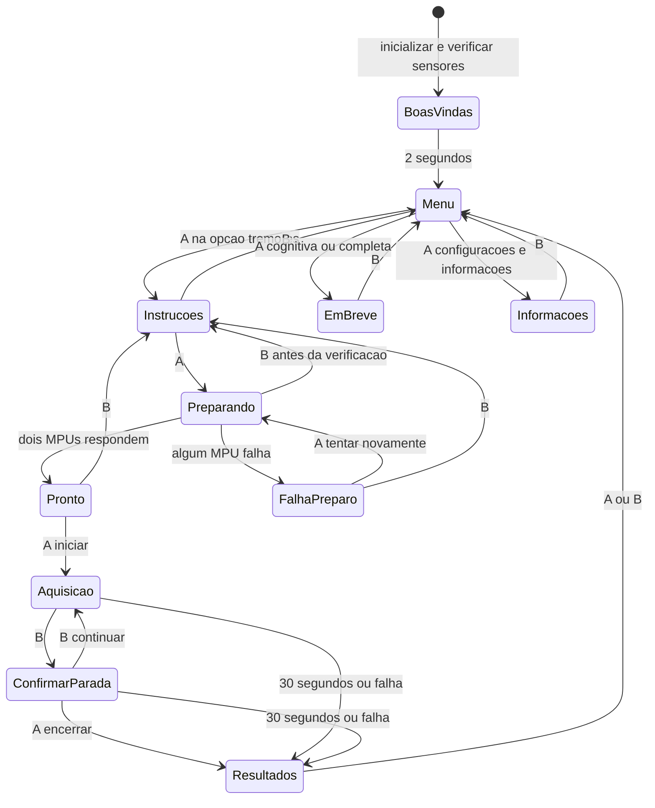

# Task: navegação por FSM e sessão de monitoramento

> Este guia descreve a etapa anterior. A task 06 adicionou o submenu cognitivo e o
> MOT; consulte [MOT adaptado](mot-adaptado.md). As demais avaliações seguem futuras.

## Objetivo e limites

Organizar a navegação e controlar quando uma sessão começa e termina, mantendo
`main.c` pequena. O menu inclui monitoramento de tremores, avaliação cognitiva,
avaliação completa e configurações/informações. As duas avaliações futuras
mostram **EM BREVE**. Configurações/informações mostra os valores fixos atuais,
sem implementar edição de parâmetros nesta task.

Nesta etapa, os resultados são um resumo técnico da aquisição: duração, leituras
válidas e falhas por sensor, e motivo de término. Não são uma medida clínica de
tremor. Não implementamos avaliação cognitiva, filtros, FFT, armazenamento em
flash ou transmissão por rede.

## Conceitos necessários

- **Estado:** representa a etapa atual, como MENU ou PRONTO.
- **Evento:** algo que aconteceu, como pressionar A ou vencer um prazo.
- **Transição:** mudança de estado causada por um evento. A no menu abre a opção;
  A em PRONTO inicia a sessão. O mesmo botão tem uma ação diferente por estado.
- **Ação de entrada:** executada uma vez ao entrar num estado, como desenhar a tela.
- **Polling:** consultar os controles periodicamente, aqui a cada ciclo com uma
  pausa de 5 ms no loop principal. As operações I2C também consomem tempo.
- **Debounce:** aceitar um botão somente após seu nível ficar estável por 30 ms.
  Isso evita que um único toque seja interpretado como vários pressionamentos.
- **Borda:** gerar evento ao pressionar, sem repeti-lo enquanto o botão fica segurado.
- **Histerese:** usar limites diferentes para sair do centro do joystick e retornar
  a ele, evitando mudanças repetidas causadas por pequenas oscilações do ADC.
- **Agendamento cooperativo:** verificar se chegou o horário de uma leitura e
  retornar ao loop. Não é necessário RTOS, interrupção ou segundo núcleo aqui.

## Arquitetura e arquivos

| Arquivo | Responsabilidade |
|---|---|
| `main.c` | Chamar `app_init()` e repetir `app_update()` |
| `include/app.h`, `src/app.c` | FSM, menu, telas, duração e confirmação de parada |
| `include/controls.h`, `src/controls.c` | GPIO/ADC, debounce e eventos de entrada |
| `include/monitoring.h`, `src/monitoring.c` | Preparar MPUs, adquirir, converter, contar e encerrar |
| `display.c`, `mpu6050_i2c.c`, `matrix.c` | Drivers já existentes, reutilizados pela aplicação |
| `CMakeLists.txt` | Novos fontes, biblioteca `hardware_adc` e limite de espera USB |
| `diagram.json` | Alimentação explícita de 3,3 V/GND para o joystick |
| `tests/` | Verificação da lógica no PC com substitutos dos periféricos |

Fluxo de chamadas: `main → app → controls/monitoring/display → drivers/SDK`.
As funções auxiliares privadas usam `static`: ficam restritas ao arquivo que as
implementa. Os cabeçalhos publicam apenas a interface entre os módulos.

## Estados e transições



No boot, a aplicação inicializa USB, controles, OLED, matriz apagada e barramento
dos MPUs. Faz uma verificação dos sensores e só então exibe as boas-vindas e o
status de cada MPU por dois segundos. Um sensor ausente não bloqueia o menu.
O OLED usa rótulos abreviados para caber nos 15 caracteres úteis por linha.

Antes de iniciar uma sessão, os dois MPUs são reinicializados, configurados e
lidos. Essas leituras de preparação não entram nas contagens da sessão. O usuário
precisa confirmar novamente na tela PRONTO. Nenhuma amostra de sessão é coletada
no menu, nas instruções ou enquanto aguarda esse comando.

Ao pressionar B durante a coleta, o diálogo informa **COLETA CONTINUA**. A confirma
o encerramento; B fecha o diálogo e continua a mesma sessão, sem zerar o tempo.
O prazo de 30 segundos continua contando. Falha de qualquer sensor encerra a
sessão inteira com motivo explícito; não há reinicialização automática durante
a coleta. A próxima sessão permite tentar preparar os sensores novamente.

## Controles e tempos

- A: GPIO 5, entrada com pull-up; pressionado corresponde a zero.
- B: GPIO 6, mesma configuração. Se A e B gerarem eventos juntos, B tem prioridade.
- Eixo vertical: GPIO 26, ADC0. GPIO 27 e botão do joystick não são usados nesta task.
- ADC abaixo de 1000 seleciona para baixo; acima de 3000, para cima.
  Voltar à faixa 1500–2500 por 30 ms rearma a seleção.
- Um deslocamento seleciona uma opção. Segurar não percorre o menu repetidamente.
  A seleção é circular: acima da primeira opção está a última.
- `MONITORING_SAMPLE_MS`: 40 ms; `MONITORING_DURATION_MS`: 30000 ms, em `monitoring.h`.
- OLED durante aquisição: 200 ms; boas-vindas: 2000 ms, em `app.c`.

A polaridade de VERT segue a [documentação do joystick Wokwi](https://docs.wokwi.com/parts/wokwi-analog-joystick).
Na placa, confirme o sentido físico; uma montagem invertida pode exigir inverter
as direções em `controls.c`. Se alterar a duração, ajuste também os rótulos das telas.

A preparação ainda usa o reset bloqueante dos drivers (~400 ms para dois MPUs).
Durante essa operação curta, a leitura dos controles pausa. Na aquisição não há
`sleep_until`: o módulo retorna ao loop quando ainda não venceu o prazo. I2C e OLED
continuam síncronos; a taxa de 25 Hz é alvo, não garantia de tempo real. Uma amostra
atrasada não é compensada com leituras em rajada. O USB tem espera limitada a 1 ms
por tentativa de escrita; um monitor muito lento pode perder saída serial.

## Dados e resultados

Durante a aquisição, o USB envia:

```text
tempo_ms,mpu,status,ax_g,ay_g,az_g,gx_dps,gy_dps,gz_dps
```

Cada linha representa um sensor, com timestamp de término da leitura desde o boot.
O OLED mostra aceleração em mg e velocidade angular em graus/s nos eixos XYZ.
As faixas permanecem ±2 g e ±250 graus/s após reset. Os dados incluem gravidade,
movimento voluntário e ruído; não estimam frequência nem intensidade do tremor.

O resumo serial inicia com `# RESULTADO`, com duração, contagens e motivo:
0 = concluída por tempo; 1 = interrompida pelo usuário; 2 = falha de sensor.
O resumo é emitido ao encerrar, se houver conexão USB, e reapresentado ao reconectar
quando não houver sessão ativa. Linhas iniciadas por `#` são mensagens, não amostras CSV.

O último resumo fica em RAM até começar outra sessão ou desligar. As amostras
individuais são transmitidas, mas não armazenadas no dispositivo. Para guardá-las,
capture a saída serial no computador. O OLED mostra o resumo ao final; retornar ao
menu não apaga o resumo, mas não há tela de histórico nesta task.

## Compilar e testar

Na pasta do projeto, com Pico SDK, toolchain e CMake configurados:

```sh
cmake -S . -B build
cmake --build build -j 4
python3 tests/run_host_tests.py
```

Os testes no PC precisam de Python 3 e `cc` (GCC ou Clang). Os stubs em `tests/stubs`
são usados somente por esses testes, nunca pelo firmware. Eles verificam controles,
transições, temporização lógica, contagens, falhas e largura das telas; não simulam
a eletrônica nem o tempo real do barramento.

Neste ambiente, se `cmake` não estiver no PATH, o executável instalado é:

```sh
/home/kauanmateus/.pico-sdk/cmake/v4.3.4/bin/cmake --build build -j 4
```

Na placa: conecte segurando BOOTSEL, copie `build/tremo_device.uf2` para o volume
RPI-RP2, aguarde reiniciar e abra a porta serial USB. Use alimentação e conexões
adequadas aos MPUs em 0x68/0x69; mantenha terra comum.

No Wokwi: compile e inicie a simulação com `wokwi.toml`, que já aponta para esse
UF2. Use o joystick e os botões A/B; altere aceleração/rotação de cada MPU nos seus
controles para conferir os valores. Para testar ausência, desconecte SDA de um
MPU no diagrama de teste e reinicie. A falha durante aquisição é coberta pelos
testes de lógica; valide também na placa ao interromper a conexão de um sensor.

## Critérios objetivos de aceitação

1. O firmware compila e os dois testes de PC terminam com PASS.
2. Após o boot, a tela informa o status dos MPUs, mostra as boas-vindas por cerca
   de 2 s e entra no menu, inclusive com um MPU ausente.
3. O joystick percorre as quatro opções. Segurá-lo não repete a seleção;
   é necessário retornar ao centro. A segurado não confirma duas telas seguidas.
4. B retorna ao menu ou à etapa anterior. No menu, B não sai da aplicação.
5. Cognitiva e completa mostram EM BREVE; informações mostra os tempos atuais.
6. Sem dois sensores disponíveis, a tela de erro permite tentar novamente ou voltar.
7. Mesmo com sensores disponíveis, não há linhas de amostras CSV até A em PRONTO.
8. Durante a sessão, ambos os sensores aparecem no OLED e no serial; a configuração
   nominal é 40 ms por ciclo e 200 ms por atualização do OLED.
9. B abre a confirmação sem sobrescrevê-la com dados; B cancela a parada sem zerar
   contagens e A encerra. O limite de tempo funciona também com o diálogo aberto.
10. O término normal ocorre em cerca de 30 s. Falha de sensor termina com FALHA SENSOR.
11. Após encerrar, as contagens ficam estáveis e não há novas amostras. Uma nova
    sessão começa com contagens zeradas. Conectar USB após o término entrega o resumo.

## Integração

Não é necessário alterar chamadas de drivers: `app_init()` faz a inicialização e
`app_update()` controla o fluxo. O CMake inclui os dois novos módulos e `hardware_adc`.
A antiga chamada direta de `monitoring_update()` na `main` foi removida.
As futuras avaliações devem ganhar módulos próprios e estados/transições em `app.c`;
não devem ser adicionadas ao loop da `main`.
