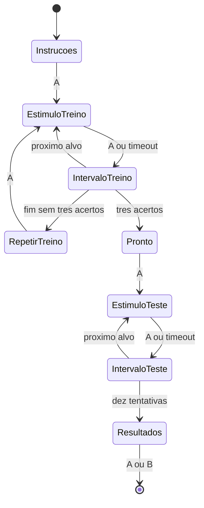

# Task 06 — MOT adaptado à BitDogLab

## Objetivo e escopo

Apresentar um alvo por vez, permitir localizar/selecionar esse alvo e registrar
acertos, erros, omissões e tempos de resposta. Introduzir o participante aos
controles, com treinamento separado da etapa avaliativa.

O [MOT oficial da Cambridge Cognition](https://cambridgecognition.com/motor-screening-task-mot/)
utiliza alvos em diferentes posições de uma tela sensível ao toque e inclui
medidas de precisão espacial. Aqui a resposta é feita com joystick e botão sobre
uma grade 5×5. **Esta é uma adaptação experimental própria, não a implementação
oficial do CANTAB nem um instrumento validado ou equivalente aos seus escores.**
A acurácia binária por célula e o tempo de seleção por joystick têm significados
diferentes de uma resposta por toque. Não há interpretação clínica automática.

O repositório já possui a base de build, drivers principais, FSM e menu. O driver
de buzzer e o gerenciamento geral de sessões (identificador, configurações e pausa)
ainda não foram implementados. Não são necessários para executar esta primeira
versão do MOT. Esta task não implementa RTI, PRM, PAL, bateria completa nem coleta
simultânea de MPU. Essas opções continuam como EM BREVE.

## Conceitos usados

- **Coordenadas lógicas:** `(x, y)` varia de 0 a 4, com origem no canto superior
  esquerdo. O código do teste não precisa conhecer a serpentina elétrica dos LEDs.
- **Estado e evento:** o MOT possui sua própria pequena FSM. A FSM principal entra
  em APP_MOT e delega o teste a `mot_update()`, mantendo o loop da `main` inalterado.
- **Tentativa:** começa com a apresentação de um alvo e termina na primeira seleção,
  no limite de tempo ou na interrupção. Uma seleção errada não pode ser corrigida
  dentro da mesma tentativa; na próxima, o cursor retorna ao centro.
- **Separação entre treino e avaliação:** dados do treino são identificados e
  mantidos separados; não entram nos números avaliativos.
- **Timestamp:** o relógio monotônico em microssegundos identifica a apresentação
  e o instante em que a resposta foi aceita pelo software. Resolução do relógio
  não é sinônimo de precisão física do teste.
- **Buffer fixo:** um vetor de 13 registros limita o uso de memória e dispensa malloc.

## Arquivos e integração

| Arquivos | Função |
|---|---|
| `include/mot.h`, `src/mot.c` | Protocolo local, FSM do teste, estímulos, registros e resultados |
| `include/controls.h`, `src/controls.c` | Acrescentar esquerda/direita via ADC1/GPIO 27 |
| `include/matrix.h`, `src/matrix.c` | `npSetPixel(x, y, r, g, b)` para a grade 5×5 |
| `include/app.h`, `src/app.c` | Submenu cognitivo, entrada/saída do MOT e falha de inicialização da matriz |
| `CMakeLists.txt` | Incluir `src/mot.c` no firmware |
| `tests/` | Regressão dos controles, FSM, matriz e testes específicos do MOT |

A `main.c` permanece chamando somente `app_init()` e `app_update()`. Durante APP_MOT,
a aplicação retorna antes do código de monitoramento: não lê MPUs e não publica
saída desse módulo. A presença dos MPUs não é requisito para executar o MOT.

Não é necessário alterar o diagrama: os dois eixos do joystick já estão conectados
nos GPIOs 26/27 e a matriz está no GPIO 7. A é GPIO 5 e B é GPIO 6.

## Interação e protocolo local v1

1. Menu principal → Cognitiva → MOT.
2. Ler as instruções e pressionar A para começar o treinamento.
3. Mover o cursor azul usando o joystick até o alvo verde.
4. No mesmo local, o LED fica ciano (verde + azul). Pressionar A para selecionar.
5. Após três acertos no treinamento, aguardar a tela A INICIAR.
6. Pressionar A para iniciar dez tentativas avaliativas.
7. Ao terminar, consultar o resumo no OLED e os registros pela USB.
8. A ou B nos resultados retorna ao menu cognitivo.

O joystick move uma célula por deslocamento. É necessário voltar ao centro antes
do próximo passo. Segurar não repete; diagonais usam prioridade vertical. Nas bordas,
o cursor permanece na borda, sem dar a volta. A e B possuem debounce de 30 ms;
segurar A não seleciona automaticamente o próximo estímulo.

Parâmetros próprios do protótipo, não extraídos de um protocolo validado:

| Parâmetro | Valor |
|---|---|
| Treinamento | 3 tentativas; exige 3 acertos para liberar o teste |
| Avaliação | 10 tentativas |
| Limite por tentativa | 10 segundos |
| Intervalo entre tentativas | 1 segundo, matriz apagada |
| Posição inicial do cursor | Centro `(2, 2)` em toda tentativa |
| Alvos | Sequência fixa local v1, definida em `mot.c` |
| Brilho | Componentes de cor com valor 20/255 |

No treino, o OLED mostra ACERTOU, FORA DO ALVO ou TEMPO ESGOTADO. Se faltar algum
acerto, A repete os três alvos e B encerra. Uma repetição descarta os registros da
rodada anterior de treino. Não há limite automático de rodadas; o operador pode
encerrar com B. Na avaliação não há feedback de acerto entre tentativas, apenas
AGUARDE. A sequência fixa favorece reprodutibilidade técnica, mas permite aprendizado
e não controla efeitos de prática; isso precisa ser considerado no protocolo futuro.

B encerra imediatamente e de forma controlada, apagando a matriz e marcando
INTERROMPIDO. Não há pausa/retomada nesta task. Uma tentativa ativa ao interromper
é registrada como `aborted`; não conta como erro ou omissão. B nas instruções ou
em PRONTO também gera resultado interrompido, possivelmente sem dados avaliativos.



B em qualquer etapa anterior aos resultados encerra como interrompido. No código,
treino e teste reutilizam os estados MOT_STIMULUS/MOT_INTERVAL, diferenciados pelo
campo `training`, evitando duplicar a lógica.

## Métricas e armazenamento

Cada registro contém fase, posição do alvo, posição do cursor, desfecho,
`onset_us` e `elapsed_us`. As coordenadas começam em zero.

- `correct`: A com cursor no alvo antes do prazo.
- `wrong`: A fora do alvo antes do prazo.
- `omission`: limite atingido sem resposta aceita. No instante exato do limite,
  a omissão ganha da confirmação A.
- `aborted`: B durante um estímulo. B tem prioridade sobre seleção e timeout.

Acurácia = `100 × acertos / (acertos + erros + omissões)`, arredondada para baixo
no OLED. PC significa porcentagem. Em execução interrompida, o denominador usa
apenas tentativas avaliativas encerradas, e o resultado é parcial. Sem tentativas,
a tela informa SEM DADOS. A média de latência usa **somente acertos avaliativos**;
sem acertos, informa SEM ACERTOS. Isso evita confundir ausência de resposta com
uma resposta instantânea ou contar treino como desempenho avaliativo.

`elapsed_us` é latência de resposta em acertos/erros; em omissão/aborto é apenas
o tempo decorrido até detectar esse evento. Não use esses últimos registros para
calcular média de respostas. São mantidos apenas o último treino e o teste atual
em RAM; desligar ou entrar em um novo MOT apaga esse conjunto.

Após o encerramento, com USB conectada, o firmware envia resumo, CSV e marcador:

```text
# MOT_ADAPTADO_V1 interrupted=0 correct=8 wrong=1 omissions=1
mot,phase,trial,target_x,target_y,cursor_x,cursor_y,outcome,onset_us,elapsed_us
MOT,test,1,0,0,0,0,correct,1000000,504000
...
# MOT_END records=13
```

O exemplo é ilustrativo. `trial` começa em 1 dentro de cada fase. Reconectar o
monitor USB após encerrar reenvia os registros retidos, inclusive no menu. Isso
pode gerar duplicatas na captura do PC; não são novas execuções. Os registros ainda
não têm um identificador global de sessão. Buffering com confirmação de recebimento
e protocolo geral ficam para a task 11. O limite de espera USB existente pode
descartar saída se o host estiver lento: confira o marcador MOT_END e a quantidade
de registros; os dados permanecem em RAM para nova exportação por reconexão.

## Temporização: o que estamos medindo

O OLED é atualizado antes de acender o alvo. O relógio da tentativa começa após
`npWrite()` terminar o envio/latch. Durante o estímulo, somente movimentos do cursor
atualizam a matriz; o timestamp original é preservado. O evento de resposta é
marcado imediatamente após o polling/debounce, antes de desenhar feedback.
Não há envio serial nem atualização do OLED durante o estímulo ativo.

O tempo inclui localização, deslocamento do joystick, passos intermediários e
confirmação. Também incorpora aproximadamente 30 ms de debounce, o polling do loop
(~5 ms nominal) e custos de transmissão de LEDs. Não se subtrai uma compensação
arbitrária. O timestamp é referência de software, não medição óptica do acendimento.
Antes de avaliar precisão, use analisador lógico/fotodiodo e sinais de botão para
comparar referência física e registro. Testes no PC não substituem essa validação.

## Compilar, testar e executar

Na raiz do projeto:

```sh
cmake -S . -B build
cmake --build build -j 4
python3 tests/run_host_tests.py
```

Se CMake não estiver no PATH deste ambiente:

```sh
/home/kauanmateus/.pico-sdk/cmake/v4.3.4/bin/cmake --build build -j 4
```

Na BitDogLab, conecte segurando BOOTSEL e copie `build/tremo_device.uf2` para
RPI-RP2. Após reiniciar, abra a porta USB serial e escolha Cognitiva → MOT.
No Wokwi, compile e inicie usando `wokwi.toml`. Use as setas do joystick e os
botões A/B. O simulador não comprova precisão temporal nem visibilidade na placa.

Antes de testar com participantes, verifique fisicamente cores, orientação da
matriz e correspondência dos quatro movimentos. O mapeamento pressupõe LED 0 no
canto inferior direito, como no diagrama atual. Uma placa com outra orientação
exige ajustar `npSetPixel`. A distinção por cor e a resolução 5×5 são limitações
de usabilidade desta adaptação.

## Critérios objetivos de aceitação

1. Build e as quatro suítes de testes no PC passam.
2. Cognitiva → MOT abre instruções; RTI, PRM, PAL e bateria continuam EM BREVE.
3. A inicia treino, sem iniciar automaticamente a avaliação. Menos de três
   acertos oferece repetição; três acertos mostram PRONTO e aguardam outro A.
4. Joystick move nos quatro sentidos, exige centro entre passos e respeita bordas.
5. Alvo verde, cursor azul e sobreposição ciano aparecem nas posições esperadas.
6. A fora do alvo gera um erro; A no alvo gera acerto; inação por 10 s gera omissão.
7. São dez tentativas avaliativas. Treino não altera acurácia nem média avaliativa.
8. B encerra, apaga a matriz e preserva os registros parciais com indicação de interrupção.
9. O resultado usa média apenas de acertos e trata ausência de dados sem divisão por zero.
10. Não há leituras MPU durante o MOT, mesmo com os dois sensores conectados.
11. Após o término, o CSV identifica fases e tempos; nova conexão USB permite reexportar.
12. O fluxo anterior de tremores continua operando. Se a matriz não inicializar,
    o MOT é bloqueado e B permite voltar.

Os testes automatizados incluem uma execução com 8 acertos, 1 erro e 1 omissão,
verificando acurácia de 80%, além de limites, tempo de início após OLED, treino,
interrupção, ausência de dados e isolamento dos MPUs. A validação física permanece
pendente e deve ser registrada separadamente dos resultados do teste no PC.
